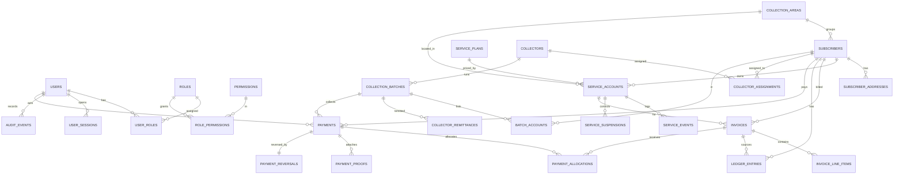

# Entity–Relationship Diagram

Rendered artifacts: **`erd.png`** (2484×960) and **`erd.svg`** in this folder. The
Mermaid source below is the same diagram embedded in `technical-documentation.md`, and
the schema of record is `../apps/api/src/db/schema.ts`.

To re-render after editing, paste the block below into any Mermaid renderer
(for example the VS Code "Markdown Preview Mermaid Support" extension, the Mermaid Live
Editor at https://mermaid.live, or the GitHub file preview) and export the image.

