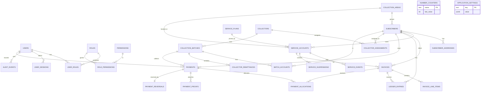

# BCIS Technical Documentation

**System:** BCIS Subscription Billing and Collection System
**Version:** 0.1.0
**Document date:** 2026-10-10
**Audience:** developers, reviewers, and the panel evaluating the laboratory activity.

---

## 1. Overview

BCIS is a three-workstation client–server system for a small Internet/Cable/Combo
subscription business. It covers the full revenue cycle: service plans, subscribers
and service accounts, monthly billing, a per-subscriber ledger, cash and GCash
payments with oldest-first allocation, collection batches and remittance
reconciliation, receivables aging and service suspension/reconnection, management
reports (PDF/XLSX), and an audit trail.

The system is split into three deployable pieces:

1. **Desktop client** (Electron + React) used by cashiers, supervisors, auditors, and
   administrators.
2. **API/server** (Fastify + Drizzle ORM) that owns all business logic and is the only
   component that talks to the database.
3. **PostgreSQL** database, reachable only by the API over the LAN.

### 1.1 Non-negotiable rules

- PostgreSQL is the single shared store; there is **no shared database file** and no
  database access from the renderer.
- All monetary values are stored and transported as **integer centavos** (₱1 = 100).
- Posted financial records are never destructively edited: payments are **reversed**,
  invoices are **voided**, and service changes are appended to history tables.
- Authorization is enforced **on the server** for every mutating (and most read)
  operations, independently of what the UI shows.

---

## 2. Architecture

### 2.1 Deployment topology (3-PC)

```
┌────────────────────┐   HTTPS/JSON   ┌────────────────────┐   TCP 5432   ┌──────────────┐
│  PC 1 Cashier      │ ─────────────▶ │  API Server (PC A) │ ───────────▶ │  PostgreSQL  │
│  Electron+React    │                │  Fastify + Drizzle │              │  (server)    │
└────────────────────┘                │  + pg / node-pg    │              └──────────────┘
┌────────────────────┐   HTTPS/JSON   │                    │
│  PC 2 Supervisor   │ ─────────────▶ │  127.0.0.1:3000    │
│  Electron+React    │                │  (LAN: 0.0.0.0+TLS)│
└────────────────────┘                └────────────────────┘
┌────────────────────┐   HTTPS/JSON          ▲
│  PC 3 Auditor/View │ ──────────────────────┘
│  Electron+React    │
└────────────────────┘
```

- The API refuses to bind to a non-loopback address without TLS (`API_TLS_CERT_FILE` /
  `API_TLS_KEY_FILE`).
- The desktop client refuses remote plain-HTTP API URLs.
- Loopback HTTP is allowed only for local development.

### 2.2 Repository layout (monorepo, npm workspaces)

```
apps/
  api/        @bcis/api        Fastify server, Drizzle schema, migrations, CLI tools, tests
  desktop/    @bcis/desktop    Electron main + preload + React renderer
packages/
  shared/     @bcis/shared     Zod contracts and shared TypeScript types
```

### 2.3 Module boundaries

| Module | Location | Responsibility |
| --- | --- | --- |
| Shared contracts | `packages/shared/src` | Zod schemas + types for every domain object, request and report. Single source of truth for validation on both sides. |
| API HTTP layer | `apps/api/src/app.ts` | Route registration, authentication/authorization prehandlers, error mapping, security headers. |
| Auth & RBAC | `apps/api/src/auth` | Password hashing, sessions, login rate limiting, user/role/permission administration. |
| Directory / catalog | `apps/api/src/catalog` | Plans, areas, subscribers, service accounts, invoices, ledger, payments, collectors, batches, receivables, service control. Two implementations: `postgres-store.ts` and `memory-store.ts`. |
| Receivables | `apps/api/src/catalog/receivables.ts` | Aging, overdue, suspension candidates (shared query logic). |
| Reports | `apps/api/src/reports` | Report catalog + builders (data → report contract) and data-source adapters. |
| Audit | `apps/api/src/audit` | Append-only audit event store (postgres + memory). |
| Integrity | `apps/api/src/db/integrity.ts` | SQL invariant checks. |
| Backup/restore | `apps/api/src/backup.ts`, `restore.ts`, `db/pg-tools.ts` | Verified, checksummed `pg_dump`/`pg_restore` orchestration. |
| Seeds | `apps/api/src/seed-admin.ts`, `seed-demo.ts`, `seed/demo.ts` | Role/permission bootstrap and demo dataset. |
| Desktop main | `apps/desktop/src/main` | Window lifecycle, API client, IPC handlers, PDF/XLSX exporters. |
| Desktop preload | `apps/desktop/src/preload` | Safe `contextBridge` surface (`window.bcis`). |
| Desktop renderer | `apps/desktop/src/renderer` | React screens (login, dashboard, subscribers, billing, payments, collections, receivables, reports). |

The `DirectoryStore` interface (`apps/api/src/catalog/types.ts`) decouples the HTTP
layer from persistence, which lets the entire API run against an in-memory store in
tests while production uses PostgreSQL with identical business rules.

---

## 3. Technology stack

| Layer | Technology |
| --- | --- |
| Desktop shell | Electron (contextIsolation on, sandbox on, nodeIntegration off), electron-vite |
| UI | React + TypeScript, plain CSS design tokens |
| API | Node.js 24, Fastify 5, Zod 4, TypeScript (ESM) |
| Persistence | PostgreSQL, Drizzle ORM + drizzle-kit migrations |
| Auth | `scrypt`/`node:crypto` password hashing, hashed opaque session tokens |
| Exports | `exceljs` (XLSX), `pdfmake` 0.3 (PDF) |
| Tests | Vitest 5 |

---

## 4. Financial model and business rules

### 4.1 Money

All amounts are integer centavos. Report columns declare `format: "money"` and the
UI/export layer divides by 100 for display only.

### 4.2 Invoices

An invoice has `subtotalCents`, `taxCents`, `totalCents`, `amountPaidCents`, and
`balanceCents`, with the invariant:

```
balanceCents = totalCents - amountPaidCents
```

Status transitions: `draft → posted → (partially_paid | paid)`, plus `void` and
`overdue`. Posting a draft writes the ledger debit; billing generation posts directly.

### 4.3 Ledger

Every subscriber has a running ledger. Each entry has `entryType` (`debit`/`credit`),
`sourceType` (`invoice`/`payment`/`adjustment`/`reversal`), `amountCents`, and a
`balanceCents` snapshot. The latest `balanceCents` always equals the subscriber's
outstanding balance. Debits come from invoices; credits from payments; reversals add
back the reversed credit as a debit.

### 4.4 Allocation (oldest-first)

A payment is applied to the subscriber's open invoices oldest-first. The remainder, if
any, is an **unallocated credit** (advance payment) retained on the payment. Allocation
is previewable (`POST /payments/preview`) before committing. Allocations are stored in
`payment_allocations` so they can be audited and reversed exactly.

### 4.5 GCash verification policy

GCash payments are created with status `pending` and a required `referenceNumber`.
They post (and allocate) only after an explicit verification:

- **Verify** → status `posted`, allocation applied, ledger credit written.
- **Reject** → status `rejected` with a note.
- **Duplicate reference** → rejected at creation with `409 Conflict`, so an
  already-used reference can never be entered twice. This satisfies AT-05.

### 4.6 Reversal, not deletion

Reversing a posted payment creates a `payment_reversals` row, flips the payment status
to `reversed`, removes its allocations, restores invoice balances, and writes an
offsetting ledger debit. The original payment remains visible with its actor and
reason. A payment can be reversed at most once.

### 4.7 Service control

Suspension writes a `service_suspensions` row (reason, actor, timestamp) and a
`service_events` transition to `SUSPENDED`. Reconnection records the reconnecting
actor, reason, and timestamp. Repeat suspensions of an already-suspended account are
blocked.

### 4.8 Numbering

Human-readable numbers (`SUB-`, `SA-`, `INV-`, `RCPT-`, `BATCH-`) are produced from the
`number_counters` table inside a transaction, so concurrent cashiers never collide
(AT-09).

---

## 5. API design

- **Base URL:** `http://127.0.0.1:3000` (dev) / `https://<host>:3000` (LAN).
- **Auth:** `Authorization: Bearer <token>` returned by `POST /auth/login`.
- **Content type:** `application/json`.
- **Errors:** `{ "error": "<message>" }` with an appropriate status (`400`, `401`,
  `403`, `404`, `409`, `429`, `503`).
- **Health:** `GET /health` (liveness), `GET /ready` (database readiness).

### 5.1 Endpoint catalog

| Group | Endpoints | Required permission |
| --- | --- | --- |
| Health | `GET /health`, `GET /ready` | none |
| Auth | `POST /auth/login`, `GET /auth/me`, `POST /auth/logout`, `POST /auth/lock` | session |
| Users | `GET /admin/users`, `GET /admin/roles`, `POST /admin/users` | `user.manage` |
| Audit | `GET /admin/audit` | `audit.view` |
| Plans | `GET/POST /plans`, `PATCH /plans/:id` | `plan.manage` (writes) |
| Areas | `GET/POST /collection-areas` | `collection.manage` (writes) |
| Subscribers | `GET/POST /subscribers`, `GET/PATCH /subscribers/:id` | `subscriber.view` / `subscriber.create` / `subscriber.update` |
| Service accounts | `GET /service-accounts`, `GET/PATCH /service-accounts/:id`, `POST /subscribers/:id/service-accounts` | `service.view` / `subscriber.create` / `subscriber.update` |
| Billing | `GET /invoices`, `GET /invoices/:id`, `POST /invoices`, `PATCH /invoices/:id`, `POST /billing/generate` | `billing.generate` |
| Ledger | `GET /ledger` | `subscriber.view` |
| Payments | `GET/POST /payments`, `GET /payments/:id`, `POST /payments/preview`, `POST /payments/:id/verify`, `POST /payments/:id/reverse` | `payment.create` / `payment.verify_gcash` / `payment.reverse` |
| Collectors | `GET/POST /collectors`, `PATCH /collectors/:id` | `collection.manage` |
| Assignments | `GET/POST /collector-assignments`, `DELETE /collector-assignments/:id` | `collection.manage` |
| Batches | `GET/POST /collection-batches`, `GET /collection-batches/:id`, `.../start`, `.../submit`, `.../remit`, `.../reconcile`, `.../close`, `.../route-sheet` | `collection.manage` / `collection.reconcile` |
| Receivables | `GET /collector-report`, `GET /aging-report`, `GET /overdue`, `GET /suspension-candidates`, `GET /suspensions`, `GET /service-accounts/:id/suspensions` | `report.view` / `subscriber.view` |
| Service control | `POST /service-accounts/:id/suspend`, `POST /service-accounts/:id/reconnect` | `service.update` |
| Reports | `GET /reports`, `GET /reports/dashboard`, `GET /reports/:key`, `GET /reports/:key/export` | `report.view` / `report.export` |

### 5.2 Roles and permissions

| Role | Grants |
| --- | --- |
| Owner / Super Admin | all permissions (bootstrap only) |
| Administrator | everything except `backup.restore` and `audit.view` |
| Cashier | `subscriber.view`, `payment.create`, `payment.verify_gcash` |
| Collection Supervisor | `subscriber.view`, `collection.manage`, `collection.reconcile`, `report.view`, `report.export` |
| Accounting / Auditor | `subscriber.view`, `payment.reverse`, `report.view`, `report.export`, `audit.view` |
| Technician | `subscriber.view`, `service.view`, `service.update` |
| Read-only Viewer | `subscriber.view`, `report.view` |

---

## 6. Desktop client design

### 6.1 Process model and security boundary

- `contextIsolation: true`, `sandbox: true`, `nodeIntegration: false`.
- The renderer has **no** Node/FS/DB access. It only sees `window.bcis`, exposed by the
  preload script through `contextBridge`.
- The preload is emitted as CommonJS (`index.cjs`) because sandboxed preload scripts
  require CJS.
- The main process holds the API session token and performs all network calls and file
  writes.

### 6.2 IPC surface

Each renderer call maps to an `ipcRenderer.invoke("bcis:*")` channel handled in the
main process, which forwards to the API and normalizes the result into a discriminated
result type (`DesktopResult<T>`, `DesktopAuthResult`, `DesktopAdminResult<T>`). The API
is never called directly from the renderer.

Export handlers (`bcis:export-report`) build the file in the main process:

- **XLSX** via `exceljs` (default import; named import breaks under Node ESM).
- **PDF** via `pdfmake` with registered standard Helvetica fonts (local access policy
  enabled for 0.3.x).

---

## 7. Security model

| Control | Implementation |
| --- | --- |
| Authentication | Username + password; passwords hashed with `node:crypto` `scrypt`; failed-attempt counter and temporary lock. |
| Sessions | Random opaque tokens; only a SHA-256 hash is stored (`user_sessions.token_hash`); expiry and revocation supported. |
| Authorization | Server-side `requirePermission(...)` prehandler on every protected route; 403 before any store access. |
| Brute force | In-memory sliding-window rate limiter per client IP on login, returning `429` with `Retry-After`. |
| Transport | TLS required beyond loopback; HSTS header only when TLS is enabled. |
| Headers | `applySecurityHeaders` sets CSP, `X-Content-Type-Options`, `X-Frame-Options`, `Referrer-Policy`, etc. |
| Validation | Every payload parsed by a shared Zod schema; malformed identifiers → `400`, unknown → `404`. |
| Audit | `audit_events` records actor, action, entity, summary, metadata, IP, user agent for logins, user creation, payment lifecycle, suspension, and backup/restore. |
| Attachments | GCash proofs: allow-listed content types (PNG/JPEG/WEBP/PDF), max 5 MB each, max 5 per payment, safe storage paths, no execution. |
| Logging | Pino structured logging with redaction; optional file transport (`LOG_FILE`) and `LOG_LEVEL`. |
| Secrets | DB password passed to `pg_dump`/`pg_restore` via `PGPASSWORD`, never on the command line. |

---

## 8. Data model

### 8.1 ERD



> A rendered `erd.png`/`erd.pdf` can be produced from this Mermaid source with any
> Mermaid renderer; the source of truth is this section and `apps/api/src/db/schema.ts`.

### 8.2 Data dictionary

**Identity & access**

| Table | Tenant key columns | Notes |
| --- | --- | --- |
| `users` | `id` PK, `username` unique | `password_hash`, `is_active`, `failed_login_count`, `locked_until`, `last_login_at`. |
| `roles` | `id` PK, `name` unique | Seeded role definitions. |
| `permissions` | `key` PK | Permission catalog. |
| `user_roles` | (`user_id`,`role_id`) PK | Many-to-many with cascade on user, restrict on role. |
| `role_permissions` | (`role_id`,`permission_key`) PK | Role → permission grants. |
| `user_sessions` | `id` PK, `token_hash` unique | `expires_at`, `revoked_at`; indexed on expiry. |
| `number_counters` | `name` PK | `last_value` for human-readable numbering. |
| `application_settings` | `key` PK | `value` JSONB settings. |

**Catalog**

| Table | Key columns | Notes |
| --- | --- | --- |
| `collection_areas` | `id`, `code` unique | `name`, `is_active`. |
| `service_plans` | `id`, `code` unique | `service_type` (INTERNET/CABLE/COMBO), `monthly_price_cents`, `installation_fee_cents`, `reconnection_fee_cents`, `speed`, `channel_count`, `is_active`. |
| `subscribers` | `id`, `account_number` unique | name parts, contact, address, `collection_area_id` FK, `billing_day`, `due_day`, `status`. |
| `subscriber_addresses` | `id`, `subscriber_id` FK | multiple labeled addresses, `is_default`. |
| `service_accounts` | `id`, `account_number` unique | `subscriber_id`, `plan_id`, `service_type`, `installation_address`, area, activation/billing dates, `current_rate_cents`, `status`. |
| `service_events` | `id`, `service_account_id` FK | status transitions with `from_status`, `to_status`, reason, actor. |
| `service_suspensions` | `id`, `service_account_id` FK | suspension/reconnection timestamps, reasons, actors. |

**Billing, ledger, payments**

| Table | Key columns | Notes |
| --- | --- | --- |
| `invoices` | `id`, `invoice_number` unique | subscriber/account, period, issue/due dates, subtotal/tax/total/amount_paid/balance, `status`, `posted_at`. |
| `invoice_line_items` | `id`, `invoice_id` FK | description, quantity, unit price, amount. |
| `ledger_entries` | `id`, `subscriber_id` FK | `entry_type`, `source_type`, `amount_cents`, running `balance_cents`, actor. Amount checks `<> 0`. |
| `payments` | `id`, `receipt_number` unique | subscriber, amount, `method`, `reference_number`, `status`, verification fields, collector/batch FKs. Amount `> 0`. |
| `payment_allocations` | `id`, `payment_id`/`invoice_id` FK | `amount_cents > 0`. |
| `payment_proofs` | `id`, `payment_id` FK | file metadata + `storage_path`; `size_bytes > 0`. |
| `payment_reversals` | `id`, `payment_id` unique FK | reason + `reversed_by_user_id`. |

**Collections**

| Table | Key columns | Notes |
| --- | --- | --- |
| `collectors` | `id`, `code` unique | name, contact, `is_active`. |
| `collector_assignments` | `id`, unique (`collector_id`,`subscriber_id`) | active route membership. |
| `collection_batches` | `id`, `batch_number` unique | collector, route date, `status`, expected/cash/non-cash/remitted/shortage/overage, lifecycle timestamps. |
| `batch_accounts` | `id`, unique (`batch_id`,`subscriber_id`) | current bill, arrears, expected, collected, `status`. |
| `collector_remittances` | `id`, unique `batch_id` | amount, reference, recorder. |

**Audit**

| Table | Key columns | Notes |
| --- | --- | --- |
| `audit_events` | `id`, `occurred_at` | actor, `action`, `entity_type`, `entity_id`, `summary`, `metadata` JSONB, IP, user agent. Append-only; indexed by time, action, actor, entity. |

### 8.3 Referential actions

- User deletion cascades sessions/user_roles but financial FKs are `set null` or
  `restrict` to preserve history.
- Subscriber-linked billing/payment FKs use `restrict` (no silent data loss).
- Child rows tied to a batch or suspension cascade with the parent.

---

## 9. Concurrency and integrity

- **Transactions:** multi-row operations (payment posting, allocation, batch
  lifecycle, user creation) run inside a database transaction, so a crash mid-payment
  leaves no partial allocation.
- **Numbering:** `number_counters` is incremented atomically inside the transaction.
- **Integrity checks** (`npm run db:integrity`) verify:
  `invoice_balance_formula`, `invoice_amount_paid_matches_allocations`,
  `payment_allocation_within_payment`, `ledger_latest_balance_matches_totals`,
  `non_negative_monetary_values`.
- **Concurrency test:** `apps/api/src/catalog/concurrency.test.ts` drives three
  simultaneous paying sessions and asserts no over-allocation and unique numbering.

---

## 10. Deployment, backup and restore

See **[DEPLOYMENT.md](../DEPLOYMENT.md)** for the full procedure: server setup, TLS and
firewall, migrations and seeds, installer, verified backup (`npm run db:backup`),
guarded restore (`npm run db:restore -- --file <archive>` with `BCIS_CONFIRM_RESTORE`),
and the three-PC validation drill.

Backups are integrity-gated, checksummed, and `pg_restore --list` verified before
being stored. Restore validates the checksum and refuses without explicit
confirmation, then re-runs the integrity checks.

---

## 11. Design decisions, limitations and future work

### Decisions

- **PostgreSQL over a shared SQLite file** for true concurrent multi-client writes,
  transactions, constraints, and a single authoritative store.
- **Zod shared contracts** so the server and desktop validate identically.
- **Two DirectoryStore implementations** to enable fast, database-free tests that share
  the production business rules.
- **Server-authoritative authorization** so hiding a button is never the security
  boundary.
- **Reverse, never delete** to preserve financial history and auditability.

### Known limitations

- No offline mode: the desktop requires reachability to the API.
- GCash proofs are stored as metadata + path; there is no in-app image viewer.
- No scheduled/automated backups (manual/scripted via CLI).
- Single-tenant; no multi-branch consolidation.

### Future work

- Collector mobile/PWA client consuming the same API.
- Background job for nightly billing and automated backups.
- Tax/discount rules and adjustment workflow.
- Two-factor authentication for administrators.

---

## 12. Traceability to the grading rubric

| Rubric area | Where addressed |
| --- | --- |
| A. Requirements & architecture | Sections 1–2; `DEPLOYMENT.md` |
| B. Database & data integrity | Section 8; `db/integrity.ts`; migrations |
| C. Billing, ledger & payment correctness | Sections 4, 9; AT-01..AT-06 in the acceptance report |
| D. Collection & receivables | Sections 4.7, 5; AT-07, AT-08 |
| E. UI/UX | `apps/desktop/src/renderer`; user manual |
| F. Security, RBAC & audit | Section 7; `app.test.ts` audit/hardening tests |
| G. Reports & dashboard | `apps/api/src/reports`; reports tests |
| H. Testing & quality | `docs/acceptance-test-report.md` |
| I. Documentation & deployment | This document, `DEPLOYMENT.md`, user manual |
| J. Demonstration & code understanding | Acceptance report §4; demo dataset |
